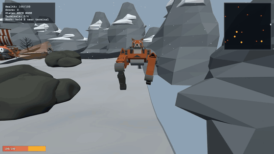
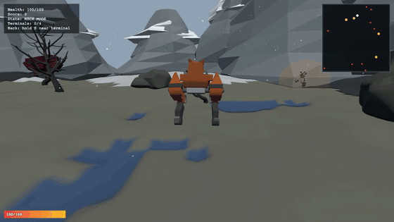
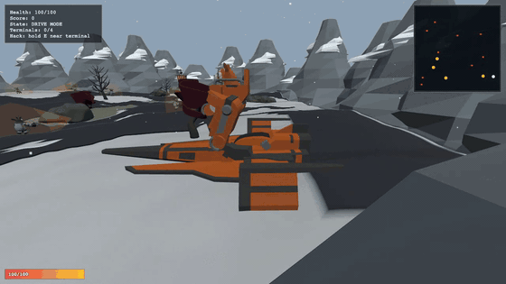
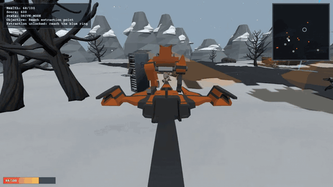

<div align="center">

# SHERPA

**A third-person stealth infiltration game in the browser, built with Three.js**



[](https://simantaahmed.github.io/SHERPA/)

   

by Simanta Ahmed

</div>

## At a Glance

- **What it is:** a 3D stealth game that runs in a desktop browser with no install. Made for COMP 4303 (AI for Games) at Memorial University, Winter 2026.
- **My role:** solo developer. I built the gameplay, enemy behaviour, HUD and minimap, level generation, and the build and deployment. The course provided the base pathfinding, steering and noise algorithms ([Credits](#credits) says exactly what came from where).
- **Tech stack:** JavaScript (ES modules), Three.js, WebGL, Vite, GitHub Actions, GitHub Pages.
- **Skills shown:** game AI (finite state machines, steering behaviours, Jump Point Search pathfinding, line-of-sight detection), procedural content generation (Perlin noise terrain, a seeded pseudorandom number generator), real-time 3D graphics, glTF models with skeletal animation, and automated deployment.

**Where to look in the code**

| What | File |
|---|---|
| Enemy AI: patrol, alert, pursue and return states, detection cones | [`js/game/lurkers.js`](js/game/lurkers.js) |
| Player modes, movement and jumping | [`js/game/player.js`](js/game/player.js) |
| Seeded random number generator | [`js/util/LCG.js`](js/util/LCG.js) |
| Terrain, water and blackout zones from noise | [`js/maps/TileMap.js`](js/maps/TileMap.js) |
| Jump Point Search pathfinding | [`js/ai/pathfinding/JPS.js`](js/ai/pathfinding/JPS.js) |
| All gameplay tuning in one place | [`js/game/tuning.js`](js/game/tuning.js) |

## Story

The term sherpa refers to a member of a Himalayan people living on the borders of Nepal and Tibet, renowned for their skill in mountaineering. The game takes place in one of the mountains of Nepal where you are infiltrating a ruin base full of Lurkers, aliens mining the mountain while damaging the landscape with a tar-like substance where man-made machines malfunction.

The player pilots a transformable mech called FOX across procedurally generated terrain. The objective each run is to locate and hack all corrupted data terminals, then reach the extraction point. The reason for doing this is to prevent the lurkers from digging out the mountains. The lurkers patrol the map and will pursue on detection. Health does not regenerate, and the full layout changes every run.

## Gameplay

<table>
  <tr>
    <td width="50%" align="center">
      <br>
      <b>Get spotted</b><br>
      <sub>Step into a lurker's cone and it raises the alarm, then opens fire.</sub>
    </td>
    <td width="50%" align="center">
      <br>
      <b>Hack a terminal</b><br>
      <sub>Hold E beside a server rack. Hacking calls nearby lurkers to you.</sub>
    </td>
  </tr>
  <tr>
    <td colspan="2" align="center">
      <br>
      <b>Extract</b><br>
      <sub>With every terminal hacked, reach the blue ring at the map centre to clear the run.</sub>
    </td>
  </tr>
</table>

<sub>The clips were recorded from the production build. A script sent the key
presses, and the lurkers ran their normal AI.</sub>

---

## How to Run

Requirements: Node.js 18 or later.

```bash
npm install
```

```bash
npm run dev
```

Open the URL shown in your terminal (typically `http://localhost:5173`).
`npm run build` produces a static build in `dist/`, which is what the link
above serves.

---

## Controls

| Key | Action |
|-----|--------|
| `W A S D` | Move |
| `T` | Toggle Mech Mode / Drive Mode |
| `Shift` | Crouch (Mech) or cut engine (Drive). Slower, and lurkers spot you from 40% less distance |
| `E` (hold) | Hack terminal while in range |
| `Space` | Jump. Jumping while moving leaps forward. Drive Mode jumps lower |
| `Hold Left Mouse` | Free-look camera, drag to orbit around player |
| `R` | Restart (on end screen) |
| `Y` | Debug shortcut, instantly unlocks extraction point (saves time when testing) |

---

## Objective

1. Find all **data terminals** (server racks) on the map, 3 to 5 per run.
2. Stand within range and hold `E` for **2.2 seconds** to complete a hack. Releasing E or getting hit cancels it, and starting a hack calls nearby lurkers to the terminal.
3. Once all terminals are hacked, a **blue extraction ring** appears at the map centre.
4. Reach the extraction ring to finish the run.

**Optional:** Find the "hidden" figure somewhere on the map for healing. Its location is never marked on the minimap.

**SHERPA is meant to be hard.** Starting a hack calls every lurker within about 43 units to you, health doesn't regenerate, and the only healing is hidden. Expect to die a lot and learn the map. Every value behind this lives in [`js/game/tuning.js`](js/game/tuning.js), so an easier mode is a one-line change.

---

## Game AI Techniques

### 1. Complex Movement: Collision Avoidance
**How to see it:** Get detected and let multiple lurkers chase you at once. They spread apart during pursuit rather than stacking on each other.

Each lurker computes a separation steering force against every other lurker within a minimum desired distance and adds it to its acceleration (`applyLurkerSeparation`). A second pass (`applyLurkerObstacleAvoidance`) pushes lurkers away from ruin bounding boxes to prevent them from clipping into obstacles.

### 2. Decision Making: State Machine
**How to see it:** Walk into a lurker's orange detection cone. A `!` sprite appears above its head. Break line-of-sight within about one second to cancel detection. If you don't, it escalates to pursuit and radios nearby units.

Two parallel state machines:
- **Player:** `MECH` <-> `DRIVE` (press T), `HACKING` (hold E near terminal)
- **Lurkers:** `PATROL` -> `ALERT` -> `PURSUE` -> `RETURN`

Implemented as a `switch` block in `updateLurkers` (`js/game/lurkers.js`).

### 3. Pathfinding: Jump Point Search
**How to see it:** Get chased over rough ground. Lurkers route around steep slopes and ruin footprints instead of steering straight at you. Once a ruin blocks their line of sight they give up and return.

`TileMap.js` discretizes the heightmap into a 2D grid with nodes blocked for steep slopes and ruin footprints. `JPS.js` finds paths by pruning nodes that aren't directional jump points, using Manhattan distance as the heuristic. Each lurker replans every 0.35 seconds. Used in `updatePursueMovement`.

### 4. Procedural Content Generation: Perlin Noise
**How to see it:** Press `R` to restart several times after dying. Terrain, ruins, blackout zones, terminal positions, and the secret character's spawn all land differently each run.

`Perlin.js` implements gradient noise based on the in-class source code. Two key changes were made from the source: (1) the constructor now accepts an `rng` parameter so the LCG drives the gradient grid instead of `Math.random()`, enabling seed-reproducible terrain; (2) the `noise()` method uses `wrapValue`/`wrapIndex` helpers to handle negative coordinate wrapping correctly, which was necessary to support the larger map size without tiling artefacts. `TileMap.js` samples it to assign height per tile. A second independent noise pass marks **blackout zones**, where the minimap shows MINIMAP SIGNAL LOST, the fog thickens and darkens, and lurker detection range doubles. Terminal candidates are filtered to open, non-blackout tiles.

### 5. Simple Movement: Pursue
**How to see it:** Once a lurker enters pursuit, run perpendicular to it. It leads its steering toward your predicted position rather than trailing you directly.

`SteeringBehaviours.pursue` projects the player's current velocity by a short time horizon to get a predicted future position, then seeks that point. Combined with JPS for routing and separation for spacing, lurkers can cut off escape angles. Used in `updatePursueMovement`.

---

## Pseudorandom Number Generation (PRNG): Linear Congruential Generator

World generation and AI randomness use a custom **Linear Congruential Generator (LCG)** implemented in `js/util/LCG.js` instead of `Math.random()`. The LCG is seeded at the start of each run using `Date.now()`.

**Algorithm** (Numerical Recipes constants):
```
s_(n+1) = (1664525 * s_n + 1013904223) % 2^31
```

The LCG drives:
- Terrain generation (passed into `Perlin.js`, gradients built from `rng.next()` instead of `Math.random()`)
- Blackout zone generation (second independent Perlin pass, same rng instance)
- Entity spawning: ruins and their scale, the terminal count and positions, lurkers, the secret character and its ship
- The distant mountains: placement, size and vertex jitter (`js/game/scenery.js`)
- AI randomness: patrol targets, wander angles (`SteeringBehaviours.wander`), shot cooldowns

The one exception is snow. It is cosmetic and respawns every frame, so it uses `Math.random()` and leaves the seeded sequence alone.

I wrote it instead of using `Math.random()` so a whole world can be rebuilt from a single number, which also makes bugs reproducible.

**How to see it:** Change `const seed = Date.now()` in `main.js` to a fixed number (e.g. `12345`). Every restart then generates the same terrain, ruins, terminals, lurker spawns and secret character. Lurker behaviour still varies between runs: the AI draws from the same sequence, but when it draws depends on frame timing and on what you do.

---

## Credits

### 3D models

All models are used under their own licences, which are listed below. They are
not covered by this repository's code licence.

| Model | Used for | Author | Licence |
|---|---|---|---|
| [Mech](https://poly.pizza/m/D5wW2jDO42) | Player (FOX) | Quaternius | CC0 1.0 |
| [Spaceship](https://poly.pizza/m/uCeLfsdmNP) | Drive mode | Quaternius | CC0 1.0 |
| [Ship](https://poly.pizza/m/mEQj2wZ3GC) | Prop beside the secret character | Quaternius | CC0 1.0 |
| [Astronaut](https://poly.pizza/m/OgeSH89Nmx) | Lurkers | Quaternius | CC0 1.0 |
| [Dead Tree](https://poly.pizza/m/Mcd2zYqyww) | Scenery | Quaternius | CC0 1.0 |
| [Tree Spiral](https://poly.pizza/m/poFJzEWCk8) | Scenery | Quaternius | CC0 1.0 |
| [Rock](https://poly.pizza/m/e1rgb5i2kF) | Scenery | Quaternius | CC0 1.0 |
| [Server rack](https://poly.pizza/m/6ijQclm8jxw) | Data terminals | Jeremy Eyring | [CC BY 3.0](https://creativecommons.org/licenses/by/3.0/) |
| [Sherma](https://sketchfab.com/3d-models/sherma-hollow-knight-silksong-e1541d1c0b134b85a7da3b1bfa6cf0da) | Secret character | Lunorvyn | [CC BY 4.0](https://creativecommons.org/licenses/by/4.0/) |

The secret character is a small fan nod to *Hollow Knight: Silksong*: Sherma,
who shows a line from his in-game song when you find him (audio was left out to
keep gameplay smooth). The model is fan art, and the character and song belong
to Team Cherry. This project is non-commercial and not affiliated with or
endorsed by them.

### Font

The end screens use [Press Start 2P](https://fonts.google.com/specimen/Press+Start+2P)
by CodeMan38, under the SIL Open Font License, bundled through `@fontsource/press-start-2p`.

### Code

Three.js only does the rendering. Nothing else is a library: the steering,
pathfinding, state machines and noise are course code or mine.

From the in-class pack: steering behaviours, pathfinding (JPS, Pathfinder,
MinHeap), the state machine base, the tile map and the Perlin implementation.
Published with the instructor's permission.

Mine: the game on top of it. The player and lurker state machines, detection
and pursuit, hacking and extraction, the minimap and fog, blackout zones,
water tiles, the animations, the seeded LCG, and everything that makes a run
reproducible from one seed. [Changes from Starter / In-Class Source Code](#changes-from-starter--in-class-source-code)
says what I changed in the pack files.

## Code Layout

I split the game out of `World.js` after the course ended; it had grown to
about 2,600 lines in one file. The project was built locally during the course
and added to git in one go after that refactor, so the history starts there.

```
js/World.js         game state, init/update/render, wiring
js/game/player.js   mech and drive modes, movement, jumping, animation
js/game/lurkers.js  spawning, the patrol/alert/pursue/return machine, steering
js/game/objectives.js  terminals, extraction point, secret character
js/game/scenery.js  atmosphere, mountains, fog, snow, ruins
js/game/hud.js      HUD and minimap
js/game/camera.js   follow and free-look camera
js/game/tuning.js   every gameplay number: speeds, ranges, timers, damage
js/ai, js/maps, js/pcg   pathfinding, tiles and noise (see Credits)
```

---

## Creative Additions

### Water Tiles: Walkable with Speed Penalty
Water tiles are walkable, but slow the player down significantly. When the player is on a water tile, movement speed, acceleration, and drag are all penalised. Water tiles are assigned a higher movement cost in `Tile.js` and are considered walkable in both `Tile.isWalkable` and `TileMap.isTileWalkable`. This adds tactical depth. Crossing water to escape a lurker is possible but risky.

### Jump-Forward Mechanic
If the player is moving and presses jump (`Space`), they leap forward in the direction they are facing. This works in both Mech and Drive modes (Drive mode uses a lower jump height). Useful for crossing water quickly or breaking a lurker's pursuit angle.

### Drive Mode Using Two Models
Drive Mode puts a ship model under the mech, combining two separate models into one vehicle with its own speed and jump settings.

---

## Changes from Starter / In-Class Source Code

(Referenced from [Credits](#credits).)

### `pcg/Perlin.js`
Adapted from `perlin-source-mar19`. Two changes from the original:
1. Constructor accepts an `rng` parameter (`{ next() }` interface), so the LCG is passed in, replacing all `Math.random()` calls so terrain is seed-reproducible.
2. `wrapValue` / `wrapIndex` helpers replace the raw modulo in `noise()` to correctly handle negative coordinates that appear at large map sizes.

### `util/LCG.js` (new file)
Custom LCG PRNG. Not present in any starter code zip. Written from scratch following the algorithm from the pseudorandomness lecture slides (linear congruential generator, Numerical Recipes constants).

### `maps/TileMap.js`
Extended from starter code to: pass `this.rng` into both `Perlin` instances; add water tile type, blackout zone generation, and walkability cost weighting.

### `maps/Tile.js`
Added `Water` tile type and updated `isWalkable` and movement cost logic.

### `World.js` and `js/game/`
The game itself: the loop, the player and lurker state machines, hacking, extraction, the HUD and minimap, and health. It started in `World.js` and now lives in `js/game/` (see [Code Layout](#code-layout)). The prototype's `Math.random()` calls were moved onto the seeded LCG.

### No modifications to core AI files
`JPS.js`, `SteeringBehaviours.js` and `State.js` were used as provided from source. `SteeringBehaviours.wander` already accepted an optional `rng` parameter, and the lurkers now pass the LCG into it.

---

## Known Bugs

- After hacking a terminal while in Drive Mode, the player returns to Mech Mode but the ship model stays underneath.
- Random spawning can occasionally place the player inside geometry. Refreshing the browser resolves this; it is very rare.
- Camera orbit can occasionally drift; it is centred on the player rather than cursor-driven.
- Lurkers take about a second to go from alert to pursuit. That delay is deliberate so they don't lock on the instant you enter a cone.

---

## Dev Notes

The project is paused for now. Next up when I return to it:

- Rigging FOX and the lurkers properly, so the animations stop relying on the stock clips.
- Remodelling the main assets to give the game its own look instead of the free models listed in [Credits](#credits).
